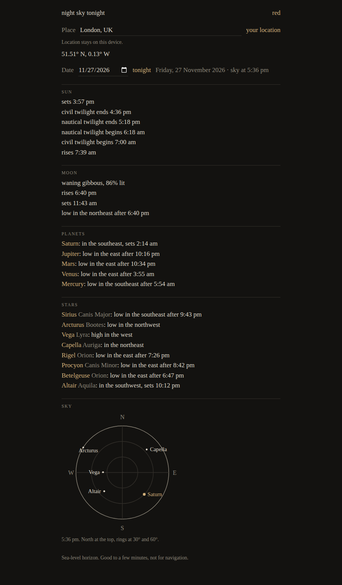

# night-sky-tonight

See which planets, the Moon and bright stars are up tonight from where you are.

https://frozenmango8.github.io/night-sky-tonight/



## Accuracy

Positions are computed in the browser with [astronomy-engine](https://github.com/cosinekitty/astronomy). Sun and Moon rise and set usually fall within a couple of minutes of an almanac; the weather changes refraction. Moon phase is within about a degree. Directions are for the naked eye, not a telescope. Star places are J2000 and have drifted by less than a degree. A city uses that city's time zone. Typed coordinates use the nearest whole-hour meridian, with no daylight saving.

The location never leaves the device.

## Run locally

```
npm install
npm test
npm run dev
```

The dev server is at http://localhost:5173/night-sky-tonight/
